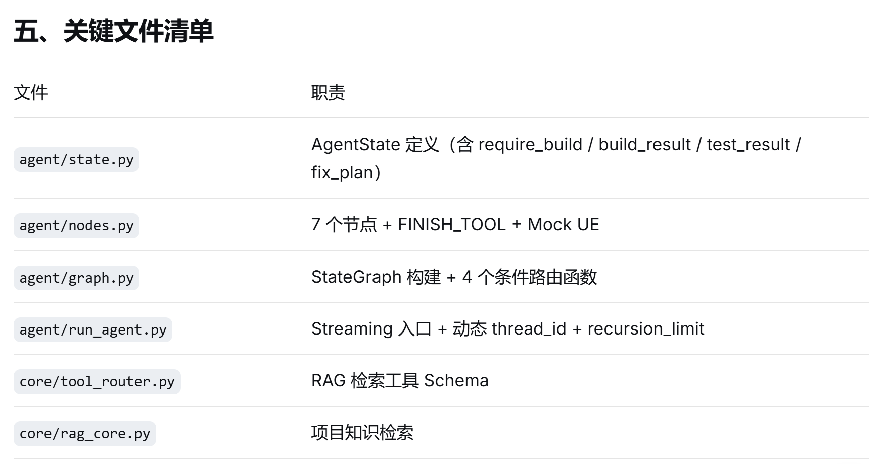
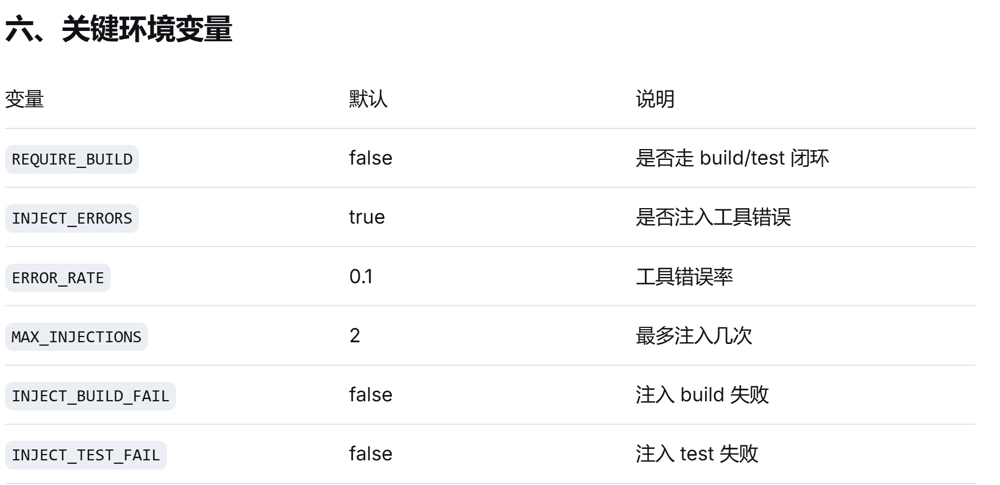

`REQUIRE_BUILD`、`INJECT_ERRORS`、`INJECT_BUILD_FAIL`、`INJECT_TEST_FAIL` 只在 `UE_EXEC_MODE=mock` 时生效。`real` 下裁判走 `judge.py`。日常入口是 `agent/run_task.py`。

# Actor 任务（默认）

python agent/run_agent.py

# Build 任务

$env:REQUIRE_BUILD="true"; python agent/run_agent.py
Remove-Item Env:REQUIRE_BUILD

# 完全关闭注入（happy path）

$env:INJECT_ERRORS="false"; python agent/run_agent.py

# 稳定触发 1 次工具错误

$env:ERROR_RATE="1.0"; $env:MAX_INJECTIONS="1"; python agent/run_agent.py

# Build 失败 → fix → 恢复

$env:REQUIRE_BUILD="true"; $env:INJECT_BUILD_FAIL="true"; python agent/run_agent.py

# Test 失败 → fix → 恢复

$env:REQUIRE_BUILD="true"; $env:INJECT_TEST_FAIL="true"; python agent/run_agent.py

# 清理全部环境变量

Remove-Item Env:REQUIRE_BUILD, Env:INJECT_ERRORS, Env:INJECT_BUILD_FAIL, Env:INJECT_TEST_FAIL, Env:ERROR_RATE, Env:MAX_INJECTIONS -ErrorAction SilentlyContinue

# 查看实际运行的函数源码

python -c "import inspect; import agent.nodes as n; print(inspect.getsource(n.observe_node))"

# 查看图结构

python -c "from agent.graph import builder; [print(e) for e in builder.compile().get_graph().edges]"

# 清理缓存

Remove-Item -Recurse -Force agent\__pycache__ -ErrorAction SilentlyContinue

# 清理 checkpoint

Remove-Item agent_checkpoints.db -ErrorAction SilentlyContinue

# 列出所有 thread

python -c "import sqlite3; c=sqlite3.connect('agent_checkpoints.db'); print(c.execute('SELECT thread_id, COUNT(*) FROM checkpoints GROUP BY thread_id').fetchall())"
